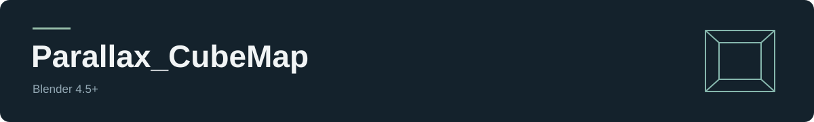
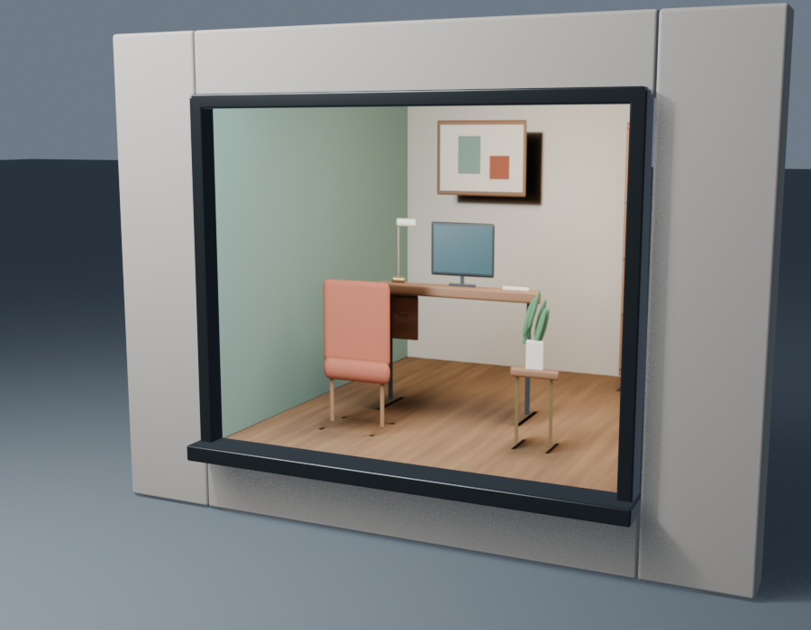
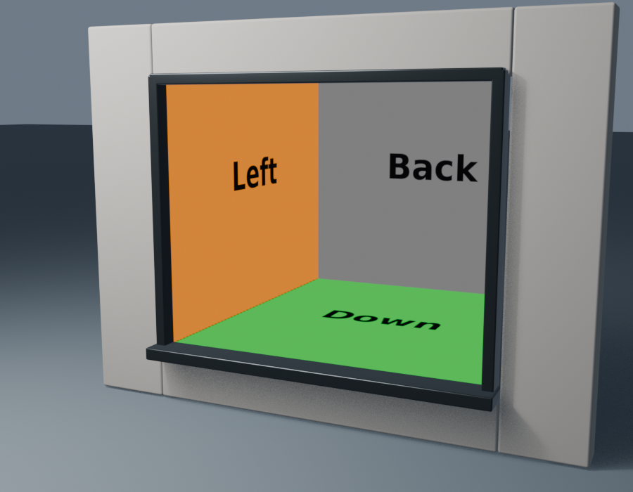

  

  
  
  
  

# Parallax_CubeMap

Материал для окон в Blender: объёмная комната с параллаксом по существующей UV-развёртке.
Поворот, зеркальность и положение UV меняют отображаемый участок комнаты.

  <a href="https://github.com/ArturPakkk/Parallax_CubeMap_Blender_Plugine/releases/latest"><b>Скачать плагин</b></a> ·
  <a href="README_RU.md">Краткая инструкция</a> ·
  <a href="README_EN.md">English</a>

<table>
  <tr><th>Комната</th><th>Debug-текстура</th></tr>
  <tr>
    <td></td>
    <td></td>
  </tr>
  <tr><td>Обычный режим материала</td><td>Проверка сторон и ориентации UV</td></tr>
</table>

## Что умеет

- Показывать интерьер на плоской грани окна.
- Читать готовую UV-карту в пределах **0–1**, включая повороты и зеркальность.
- Переключать комнату и диагностический атлас.
- Сохранять прежние материалы в blend-файле и возвращать их спустя время.
- Убирать свободный слот Debug после возврата.
- Работать с Undo/Redo и русским или английским интерфейсом Blender.

## Установка

Нужен **Blender 4.5 или новее**.

1. Скачайте **Parallax_CubeMap_2.0.0.zip** из [Releases](https://github.com/ArturPakkk/Parallax_CubeMap_Blender_Plugine/releases/latest).
2. Отключите **PX CubeMap Windows**, если пользуетесь старой версией.
3. Откройте **Edit → Preferences → Add-ons → Install from Disk** и выберите ZIP.
4. Выберите окно с готовыми UV и откройте **N → Parallax**.

| Кнопка | Что делает |
| --- | --- |
| **Назначить материал** / Assign Material | Назначает Debug_Parallax и сохраняет прежние материалы |
| **Debug-текстура** / Debug Texture | Включает и выключает проверочный атлас |
| **Вернуть материалы** / Restore Materials | Возвращает сохранённые назначения и убирает свободный Debug-слот |

В Edit Mode кнопки обрабатывают выделенные грани и завершают действие в Object Mode;
**Tab** возвращает к редактированию.

## Подробнее

[Проверка кода и ограничения](docs/AUDIT.md) ·
[Сборка и тесты](docs/DEVELOPMENT.md) ·
[Изменения версии 2.0](docs/RELEASE_NOTES.md) ·
[Участие в разработке](CONTRIBUTING.md) ·
[Безопасность](SECURITY.md) ·
[Сообщить о проблеме](https://github.com/ArturPakkk/Parallax_CubeMap_Blender_Plugine/issues)

## Лицензия и текстуры

Код и собственные ресурсы — [GPL-3.0-or-later](LICENSE).
Комнатный атлас создан из собственной сцены Blender, проверочная текстура — работа ArturPakkk.
[Границы лицензии](docs/LICENSING.md) · [Источники ресурсов](ASSET_NOTICE.txt) · [Сторонние компоненты](THIRD_PARTY_NOTICES.md)
